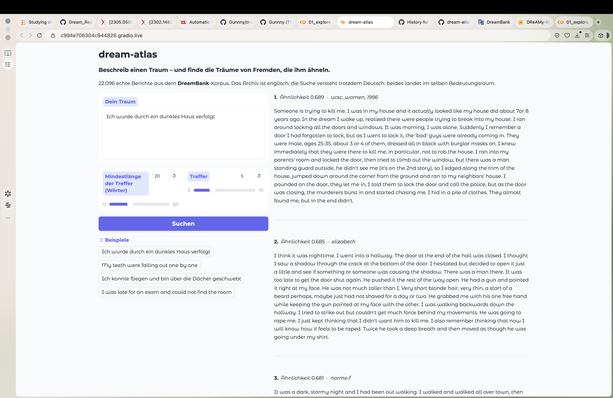
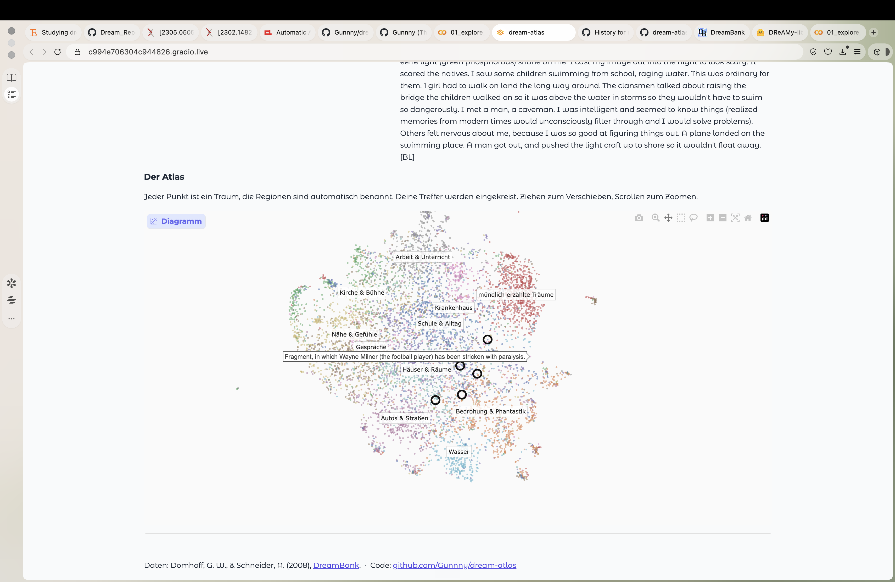

# dream-atlas

An interactive atlas of dream reports — find the dreams of strangers that resemble your own.




**[Live demo]()** <!-- TODO: Hugging Face Space URL -->

---

## What this is

A semantic search engine over 22,096 real dream reports from the [DreamBank](https://dreambank.net/) corpus.
You describe a dream — in English **or German** — and get back the dreams from the archive that are
closest in meaning, not in wording. Every result is placed on a map of the whole corpus.

The interesting part is not that it works. It is **by how much**, and where it fails.

> **Content note.** The archive contains real dream reports, including accounts of violence,
> sexual assault and death. Search results are not filtered, because filtering them would remove
> a substantial part of what people actually dream about and silently bias any analysis built on
> the corpus. The interface warns the user instead.

---

## Results

Precision@5 over a hand-built evaluation set of 20 queries:

| Method | P@5 |
|---|---|
| TF-IDF (lexical baseline) | 0.360 |
| Multilingual sentence embeddings | 0.560 |
| Embeddings, minimum-length filter | 0.580 |
| Embeddings, framing phrases removed | **0.600** |

The last two rows are independent variants, not stacked on each other.

In plain terms: the lexical baseline returns 1.8 useful results out of 5, the best
embedding setup 3.0.

### Why embeddings win

TF-IDF compares strings, not meaning. Two concrete failures from the same query:

- **Synonyms.** Changing *"chased"* to *"pursued"* in the query drops the top similarity
  from 0.413 to 0.293, and none of the five chase dreams found by the first query appear
  in the results of the second.
- **Language.** A German query returns dreams that merely *mention Germany* — the method
  matches on country names, not on content.

The embedding model handles both, because it maps all languages into one shared vector space.

### Why the length filter is not the improvement it looks like

Requiring at least 20 words per report raises mean P@5 by only 0.02 — but that average hides
two real and opposing effects. The filter changes the result list for **9 of 20 queries**:
it helps 5 and hurts 4.

The pattern is systematic:

| | queries helped | queries hurt |
|---|---|---|
| Relevant documents shorter than 20 words | 1 of 5 queries | **5 of 5 queries** |

Every query the filter damaged has short relevant reports that the filter discards by construction
— for example *"My last dream was about my grandfather. He had passed away about two years ago."*
(14 words) for the *deceased relative* query.

Across the whole gold set, **11.3 % of all relevant documents are shorter than 20 words.**

A hard length cutoff therefore trades away true positives to suppress noisy short matches.
It is not a free improvement, and this evaluation cannot show that it is an improvement at all.

### The strongest signal in the embeddings was not a topic

Projecting the embeddings to two dimensions with PCA produces an undifferentiated cloud:
the first two components capture 9.4 % of the variance and separate **nothing** useful.
Colouring the retrieved results for *teeth*, *flying* and *chase* onto that projection shows
all three topics fully intermixed.

Three hypotheses were tested for what the leading component does encode:

| Hypothesis | Verdict |
|---|---|
| Topic | rejected — the three topics overlap completely |
| Report length | rejected — no gradient along either axis |
| **Narrative framing** | **confirmed** |

Reading the documents at both extremes of the first component shows the split: one end holds
reports that open with a framing phrase (*"I dreamed that…"*, *"Last night I had a bizarre
dream."*), the other end reports that start straight in the scene. K-means run independently on
the same embeddings confirmed it — its **largest** cluster (3,726 of 22,096 reports, 17 %) was
characterised by the terms *dream, dreamt, dreamed, remember* rather than by any topic.

This is a corpus artefact: the sub-collections were gathered under different instructions, so
some participants habitually wrote *"I dreamed that…"* and others did not. It is not a property
of what people dream about.

**Removing those phrases raised P@5 from 0.560 to 0.600.** The rule is deliberately conservative:
it only strips a phrase at the start of a report, and only when the words between *"I had"* and
*"dream"* come from a list of content-free qualifiers. *"I had a bizarre dream"* is stripped;
*"I had some sort of sex dream"* is left untouched, because *sex* is the topic. Lucid dreams
(*"I was dreaming inside my dream"*) are never touched. See [`framing.py`](framing.py), which
ships with its own test cases.

The cleaning reaches about half the problem: 7.8 % of reports were changed, while the framing
cluster held 17 %.

### What is left of that cluster is a collection artefact

Re-clustering the cleaned embeddings leaves a group of 2,403 reports (11 %) whose characteristic
terms are *dream, like, remember, just, going, don't, know, kind*.

Most of those are not topic words but **spoken-language fillers**. These reports read like
transcribed speech rather than writing:

> *"Understandably this is the night before exams, so I had an exam dream last night. I dreamt
> that I was going to school… And then I dilly-dallied around and I was real late, and I don't
> remember anything about how that went. But then…"*

The distribution across sub-collections confirms it. Share of each series that falls into this
cluster, for series with at least 100 reports:

| Series | Share | Reports |
|---|---|---|
| jasmine3 | 65 % | 258 |
| jasmine2 | 50 % | 269 |
| miami-lab | 46 % | 274 |
| melvin | 41 % | 128 |
| peru-f | 35 % | 381 |
| … | | |
| b | 4 % | 2,845 |
| alta | 0.2 % | 422 |

A factor of 300 between the extremes. The series names — `miami-lab` / `miami-home`,
`peru-f` / `peru-m`, `blind-m`, `hall_female` — are study collectives, not individual journals,
so different studies gathered their reports in different ways. `jasmine2` and `jasmine3` are the
same person in two periods and both rank at the top, so individual narrative style contributes too.

**This is deliberately not fixed.** Catching framing language mid-report would mean removing
*dream* and *remember* anywhere in the text, which would destroy lucid dreams, dreams within
dreams and references to earlier dreams — all genuine phenomena in dream research. The artefact
is documented rather than removed.

### Cross-lingual retrieval works — on average

Every report in the archive is in English. Query it in German and the results are, in aggregate,
just as good:

| Query language | Queries | P@5 |
|---|---|---|
| German | 8 | 0.550 |
| English | 12 | 0.567 |

Those are different queries on different topics, so the set also contains three **matched pairs**:
the same dream described in both languages, everything else held constant.

| Pair | German | English | shared results |
|---|---|---|---|
| teeth falling out | 1.0 | 1.0 | 3 of 5 |
| flying over a city | 0.6 | 0.8 | 4 of 5 |
| late for an exam | **0.8** | **0.2** | **0 of 5** |

Two pairs behave as hoped. The third does not — the result lists are completely disjoint.

The cause is not the language itself but the **word choice that translation forces**. In
`...could not find the room`, the English *room* dominated the query: four of five results were
hotel rooms, dorm rooms and student rooms, and none involved an exam. In the German version
*Prüfung* dominated instead. *Room* is a dense, high-frequency setting word in an English dream
corpus; *Raum* is not its exact equivalent.

Translated query pairs are therefore only partly controlled, since translation involves lexical
decisions and those decisions drive retrieval. The aggregate figures hold, but per-query variance
is large.

---

## The atlas

The map in the interface is a UMAP projection of the same 384-dimensional embeddings, with
k-means regions drawn on top.

**Clustering runs in the original 384 dimensions, not on the 2-D projection.** UMAP distorts
distances to produce a readable picture; clustering the picture would cluster the distortion.
The projection is used for display only.

### Region labels are hand-written, and that mattered

Each cluster's most characteristic TF-IDF terms were computed as a starting point. For roughly
half the regions those terms name the region well (*water, boat, swimming, lake* → **Water**).
For the other half they do not, because the most frequent words in a cluster are not necessarily
what the cluster has in common.

The clearest case: one region's top terms were *saw, man, came, got, went, away* — generic
narrative verbs that appear in every long report. On that evidence the cluster looks like noise.
Reading fifteen of its documents suggested otherwise: hell, a hostage-taking, a medieval dungeon,
a bomb, a sword fight, machine-gun fire, a room full of snakes, a bird with a rat's face.

That observation was turned into a prediction and measured. Share of reports containing any of
a fixed list of threat and weapon terms:

| | Share |
|---|---|
| This cluster | **46.8 %** |
| Whole corpus | 19.3 % |

A factor of 2.4. The region is labelled **Threat & the fantastic**, and the label is backed by a
number rather than by an impression.

The same reasoning produced the label for the spoken-language cluster described above: it is
named **orally told dreams**, which states the collection artefact on the map instead of hiding
it behind filler words.

Top-term labelling is therefore treated here as a *starting point for reading*, not as a result.
Where a cluster resists naming after reading, the honest label is *mixed*.

---

## Method

```
OFFLINE (once, in the notebook)
  DreamBank → clean → embed all reports → UMAP → k-means
            → dreams.parquet, embeddings.npy, atlas_xy.npy,
              clusters.npy, cluster_names.json

AT QUERY TIME (in the app)
  user text → one embedding → dot product against the matrix → top-k
```

The expensive step runs once; each search is a single matrix–vector product over 22,096 rows.
The app loads the precomputed artefacts and never recomputes them — it holds no training code at all.

- **Embedding model:** `sentence-transformers/paraphrase-multilingual-MiniLM-L12-v2`, 384 dimensions,
  L2-normalised, so cosine similarity reduces to a dot product.
- **Baseline:** scikit-learn `TfidfVectorizer`, English stop words, `min_df=2`, 24,119-term vocabulary.
  The document–term matrix has 539 M cells but only 0.22 % are non-zero (9.5 MB sparse vs. 4.3 GB dense).
- **Projection:** UMAP to 2 dimensions, for display only.
- **Clustering:** k-means, k = 12, on the 384-dimensional vectors.
- **Interface:** Gradio, with the map as a Plotly scatter. The map is drawn from a fixed random
  subsample of 7,000 points; sending all 22,096 produced a payload the browser failed to render.

---

## Data

Dream reports come from **DreamBank**, via the `DReAMy-lib/DreamBank-dreams-en` dataset on the
Hugging Face Hub. Columns: `series`, `description`, `dreams`, `gender`, `year`.

Cleaning:

| Step | Rows |
|---|---|
| Raw | 22,415 |
| Removed reports with fewer than 5 words | 22,347 |
| Removed exact duplicate texts | **22,096** |

Reports under 5 words are not dreams but **titles** — `'Packing.'`, `'Unknown.'`,
`'Matthew's Graduation'`. In some series the title is stored inside the text field, and where
no narrative followed, only the title remains.

Everything above 5 words was kept. Short reports like *"I was in a hospital."* are genuine but
thin; rather than deleting them, a `word_count` column is retained so each use case can filter
for itself. Deleting rows is irreversible; filtering is not.

Framing phrases are stripped before embedding — see the Results section and [`framing.py`](framing.py).

**Known issues not yet addressed:**
- Titles are glued to the start of the text in some series (`'Blisters On My Face  I have blisters...'`)
- Bracketed waking-life notes are mixed into the text (`'[Note: I got sunburn yesterday on my face.]'`)
- Framing language mid-report — documented above, deliberately left in place

---

## Evaluation

There is no ground truth for "which of 22,096 dreams match this query". It had to be built.

**Pooling.** For each of 20 queries, the top-5 results of all three methods were collected and
merged, giving 213 unique (query, document) pairs to judge — 97 of which were marked relevant.
After the framing-phrase cleaning the pool was extended by 13 further pairs (see below), for a
final gold standard of **226 pairs, 105 relevant**.

**Criterion**, fixed in writing before judging:

> **Relevant** if the central event of the query actually occurs in the dream.
> Setting alone is not enough — a castle without a dragon does not match *"a dragon over a castle"*.
> The event need not fill the whole dream; if it clearly occurs and the dream then moves on, it counts.

**Blinding.** The judging table contained no column identifying which method produced which result,
and rows were shuffled within each query. Knowing the source would have biased the judgement toward
the method built most recently.

**Agreement.** 41 of the 213 pairs were judged independently by two annotators:
**95.1 % agreement, Cohen's κ = 0.897.** The remaining 172 were labelled by a language model
following the same written criterion. Two borderline cases were discussed afterwards and unified in
the gold standard; κ is reported from the independent pass and was not recomputed after that revision.

**Query set.** 20 queries, 8 German and 12 English, including three matched German/English pairs
that describe the same dream in both languages. Three queries (`gaming`, `dragons`, `math`) were
included as expected-hard cases for a corpus collected largely before 2000.

**Pooling bias, and why it nearly hid a real improvement.** A pool built from one set of methods
can only judge methods that retrieve similar documents. After the framing cleaning, 13 of 100
retrieved documents had never been judged and therefore counted as *not relevant* by default,
putting P@5 at 0.520 — below the 0.560 baseline. Judging those 13 (8 turned out relevant) moved
the real figure to **0.600**.

The bias was worth 8 points and inverted the sign of the result. Taking 0.520 at face value would
have meant discarding a change that actually helps. The number of unjudged results is reported
alongside every evaluation for this reason.

The full gold standard is in [`judgements_v2.csv`](judgements_v2.csv).

---

## Limitations

- **Concrete settings outrank abstract events.** Given a query with several components, the model
  latches onto the physical scene rather than onto what happens in it. Two independent cases from
  the evaluation:

  | Query | What comes back | What is missing |
  |---|---|---|
  | *being chased through a **dark house*** | dark, threatening houses | the chase, in most results |
  | *late for an exam, could not find the **room*** | hotel and dorm rooms | the exam, in all five results |

  TF-IDF does not share this failure: it insists on *chased* and on *exam*. Each method wins where
  the other loses, which is the strongest argument for the hybrid retrieval listed under next steps.
- **Most labels are not human.** 172 of 213 relevance judgements come from a language model;
  the κ above is what makes them usable, not a guarantee that they are right.
- **20 queries is small.** Differences of a few points are not meaningful at this sample size.
- **The number of regions is a choice, not a finding.** k = 12 was set by hand. No stability
  analysis was run, so the regions should be read as a readable summary of the corpus, not as
  evidence that dreams fall into twelve kinds.
- **The corpus is historical.** Many reports date from the mid-20th century, so modern topics are
  sparsely covered.
- **English archive.** German queries work through cross-lingual embeddings, but every stored
  report is in English.

---

## Next steps

- [x] Interactive atlas: UMAP projection with labelled clusters
- [x] Web interface (Gradio) and public deployment
- [ ] Hybrid retrieval: combine the lexical and semantic scores, since each wins where the other loses
- [ ] Let visitors save their own dreams and see them placed on the map
- [ ] Emotion annotation following the Hall & Van de Castle scheme
- [ ] Strip titles glued to the start of the text, and bracketed waking-life notes
- [ ] Cluster stability analysis to justify a value for k

---

## Reproducing

```bash
pip install -r requirements.txt
```

See [`notebooks/01_explore_data.ipynb`](notebooks/) — it runs top to bottom and recreates the cleaned
dataset, both indexes, the evaluation and the atlas artefacts.

<!-- TODO: add the "Open in Colab" badge -->

Raw data is not committed; the notebook downloads it. The precomputed artefacts
(`embeddings.npy` and friends, ≈34 MB) are not committed either — run the notebook to produce them,
then start the interface with:

```bash
python app.py
```

---

## References

- Domhoff, G. W., & Schneider, A. (2008). Studying dream content using the archive and search engine
  on DreamBank.net. *Consciousness and Cognition*, 17(4), 1238–1247.
  [doi:10.1016/j.concog.2008.06.010](https://doi.org/10.1016/j.concog.2008.06.010)
- Bertolini, L., et al. (2024). Automatic Annotation of Dream Report's Emotional Content with Large
  Language Models. [ACL Anthology](https://aclanthology.org/2024.clpsych-1.7/)
- [DReAMy](https://github.com/lorenzoscottb/DReAMy) — library and models for dream report analysis

---

## License

Code in this repository is MIT licensed. **This does not cover the DreamBank data**, which has its
own terms — see DreamBank for conditions of use.
